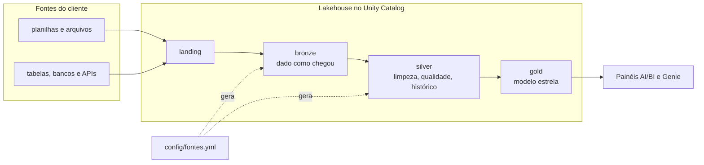
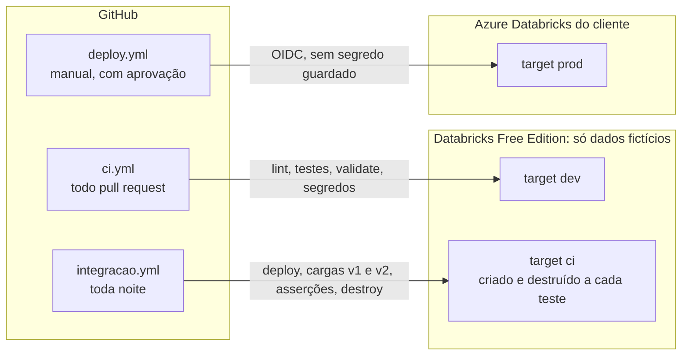

# Essentials · projeto portfolio

[](https://github.com/JoaoGama-dev/databricks-lakehouse-essentials/actions/workflows/ci.yml)
[](https://github.com/JoaoGama-dev/databricks-lakehouse-essentials/actions/workflows/integracao.yml)

Projeto de portfólio de engenharia de dados: o pacote **Essentials** da Logos Analytics,
um **lakehouse medalhão orientado por metadados** no Databricks, empacotado como
**Databricks Asset Bundle**.

## Em 1 minuto

**O problema:** pequenas e médias empresas têm dados espalhados em planilhas e sistemas,
e cada projeto de dados costuma ser escrito do zero. **A solução:** um acelerador em que
as fontes de cada cliente são descritas num arquivo, [`config/fontes.yml`](config/fontes.yml),
e a bronze e a silver são geradas a partir dele. Reaproveitar o projeto em outro cliente
é, na maior parte, trocar esse arquivo.





- **Sem dbt:** Lakeflow Spark Declarative Pipelines, serverless; bronze e silver em
  Python (`from pyspark import pipelines as dp`), gold em SQL.
- **Qualidade visível:** regras do YAML viram expectations, com histórico diário,
  alerta de atraso e painel de saúde.
- **Governança como código:** schemas, volume, permissões, máscara de dado pessoal e tags
  `pii` no bundle; o negócio lê só a gold.
- **Testado de ponta a ponta:** testes de unidade em todo PR e, toda noite, uma carga
  real com dados fictícios num ambiente isolado.
- **IA com guardrails:** Claude Code com permissões, hooks, 6 subagentes e 8 skills; o
  modelo nunca vê dados reais.

O exemplo usa duas fontes: a **agenda de entrevistas** de um RH (planilha CSV) e um
**cadastro de cargos** (tabela no Unity Catalog). A gold junta as duas para mostrar
comparecimento e aprovação por área.

## Como rodar (Free Edition)

Pré-requisitos: conta no [Databricks Free Edition](https://www.databricks.com/learn/free-edition),
Python 3.12 e a CLI do Databricks (`winget install Databricks.DatabricksCLI` no Windows,
`brew tap databricks/tap && brew install databricks` no macOS).

```
databricks auth login --host https://<seu-workspace>.cloud.databricks.com
$env:BUNDLE_VAR_alert_email = "voce@exemplo.com"      # PowerShell; não é versionado
```

1. No **SQL Editor**, rode `setup/00_setup_free_edition.sql` (catálogo e origem simulada).
2. Implante: `databricks bundle validate -t dev` e `databricks bundle deploy -t dev`.
3. Gere as agendas fictícias e envie a v1 para a landing:
   ```
   python data/gerar_dados_exemplo.py
   databricks fs mkdir dbfs:/Volumes/essentials/<schema>/landing/agenda
   databricks fs cp data/agenda_exemplo_v1.csv dbfs:/Volumes/essentials/<schema>/landing/agenda/
   ```
4. Rode a carga: `databricks bundle run essentials_carga_diaria -t dev`.
5. Confira `essentials.<schema>_gold.gold_agg_entrevista_mensal` e os painéis; depois
   envie a v2 e rode de novo para ver o histórico.

`<schema>` é `dev_<seu usuário>_portfolio` (o `deploy` mostra o nome). O passo a passo
completo, com o que conferir em cada etapa e os totais esperados, está em
[`docs/guia-free-edition.md`](docs/guia-free-edition.md).

Para desenvolver: `pip install -r requirements-dev.txt`, `pre-commit install`, e antes de
cada PR `ruff check .`, `pytest -q` e `databricks bundle validate -t dev`.

## Como adaptar a um cliente

1. Copie este repositório com o nome `essentials-<projeto>`.
2. No `databricks.yml`, troque `bundle.name` para `essentials_<projeto>`, o `default` da
   variável `projeto` e o `projeto` do target `ci` (`<projeto>_ci`).
3. Em `setup/00_setup_free_edition.sql`, troque `portfolio` pelo nome do projeto.
4. Reescreva `config/fontes.yml`, os `src/pipeline/silver_<fonte>.sql` e os
   `src/pipeline/gold_*.sql`. A skill `novo-cliente` do Claude Code conduz esse passo
   pelo **perfil** dos arquivos do cliente, sem ver os dados.
5. Leve ao Azure do cliente: [`docs/levando-ao-azure.md`](docs/levando-ao-azure.md).

## Documentação

| Assunto | Onde |
|---|---|
| Arquitetura: fluxo dos dados, job, Unity Catalog, tabelas, regras, dicionário, painéis | [`docs/arquitetura.md`](docs/arquitetura.md) |
| Rodar no Free Edition, passo a passo | [`docs/guia-free-edition.md`](docs/guia-free-edition.md) |
| Levar ao Azure Databricks do cliente | [`docs/levando-ao-azure.md`](docs/levando-ao-azure.md) |
| Operação do dia a dia, para o cliente | [`docs/roteiro-de-operacao.md`](docs/roteiro-de-operacao.md) |
| Desenvolvimento: Claude Code, fluxo dos agentes, CI/CD, cadeia de suprimentos | [`docs/desenvolvimento.md`](docs/desenvolvimento.md) |
| Padrões: nomes, camadas, LGPD, fluxo de trabalho | [`docs/padroes/`](docs/padroes/) |
| Decisões de arquitetura (ADRs) | [`docs/adr/`](docs/adr/README.md) |
| Plano de evolução para o padrão sênior | [`docs/plano-padrao-senior.md`](docs/plano-padrao-senior.md) |
| Histórico de versões | [`CHANGELOG.md`](CHANGELOG.md) |
| Regras para o Claude Code | [`CLAUDE.md`](CLAUDE.md) |

## Dados reais e LGPD

Dados reais de clientes só rodam no Azure Databricks do cliente, na assinatura dele;
no Free Edition e no repositório entram só os dados fictícios do gerador
([ADR 0010](docs/adr/0010-free-edition-so-com-dados-ficticios.md)). O telefone sai
mascarado na silver, o nome e o telefone têm máscara de coluna na gold e a tag `pii` no
Unity Catalog, e o negócio só lê a gold
([`docs/padroes/lgpd.md`](docs/padroes/lgpd.md)).

## Próximos passos

- Completar o cadastro de cargos até zerar as entrevistas com `id_cargo = -1`.
- Metric views no Unity Catalog para as taxas de comparecimento e aprovação.
- A fábrica (Fase 7 do plano): gerar um projeto de cliente novo com
  `databricks bundle init`, a partir de um template.
- **Direção futura, fora do Essentials:** um módulo de IA para o pacote Enterprise, com
  RAG sobre documentos do cliente (Vector Search sobre uma tabela de trechos gerada por
  pipeline), agente de perguntas sobre a gold (Genie e ferramentas no Unity Catalog),
  avaliação da qualidade das respostas e rastreamento (MLflow). Será um projeto separado,
  com plano próprio.

## Aviso

O **Databricks Free Edition** é só para aprendizado e uso pessoal e **não pode ser usado
comercialmente**. Projetos de clientes rodam no Azure Databricks do próprio cliente, com
a nuvem paga diretamente à Microsoft.

## Licença

© 2026 João Gama · Logos Analytics. **Todos os direitos reservados.**

Este repositório é público para fins de portfólio: você pode ler e avaliar o código, mas
não pode copiá-lo, modificá-lo, distribuí-lo nem usá-lo comercialmente sem autorização
por escrito. Os projetos de clientes ficam em repositórios privados, no GitHub de cada
cliente.
