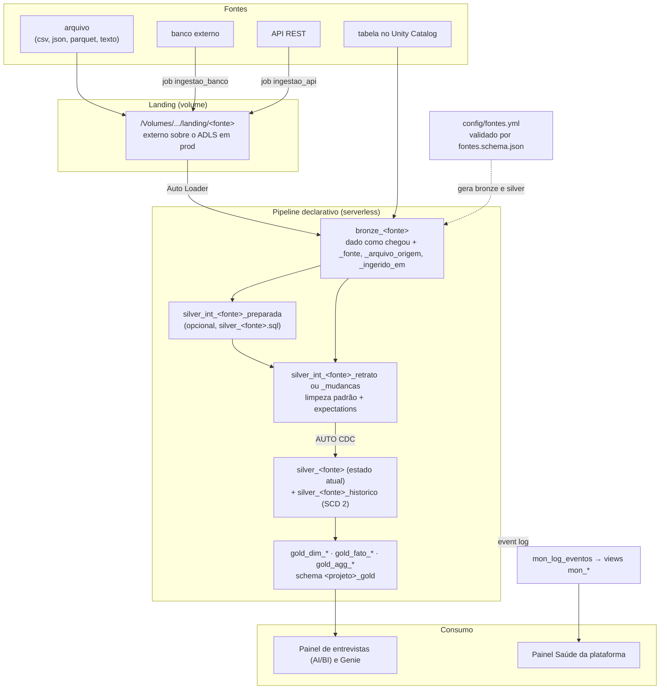
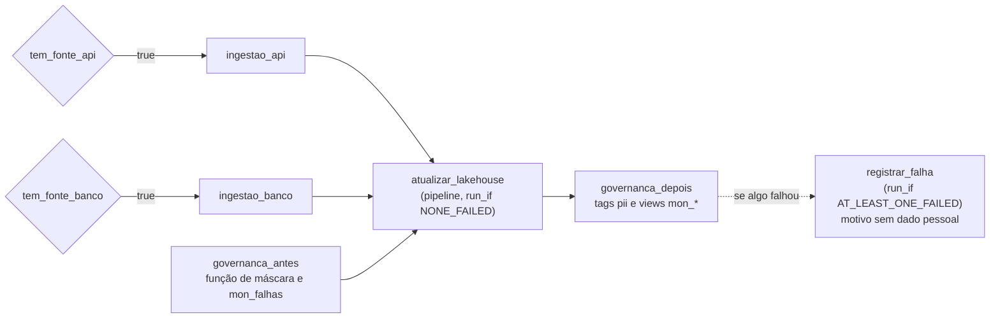

# Arquitetura

Como o pacote Essentials organiza os dados, do arquivo que chega à landing até os
painéis. As decisões por trás de cada escolha estão em [`docs/adr/`](adr/README.md).

## Fluxo dos dados



- **Bronze e silver são genéricas** (`src/pipeline/bronze.py` e `silver.py`): cada item
  do `fontes.yml` vira suas tabelas (ADR 0007).
- **As regras de qualidade ficam numa tabela intermediária**, e não numa view, porque o
  AUTO CDC FROM SNAPSHOT lê a origem como um retrato e não aplica expectations de views
  (ADR 0009). No modo incremental, ficam na própria `silver_<fonte>`.
- **AUTO CDC** nos modos `snapshot` e `cdc`, com histórico SCD tipo 2 opcional (ADR 0008).

## A carga diária (job)



Job `essentials_<projeto>_carga_diaria`, às 6h (America/Sao_Paulo) em prod; pausado em
dev. As ingestões só rodam quando o `fontes.yml` tem fonte daquele tipo (variáveis
`ingerir_banco` e `ingerir_api`, conferidas por teste); sem fonte, aparecem como puladas
e não custam nada (ADR 0004). A tarefa `registrar_falha` depende de todas as outras e só
roda quando alguma falha: grava o motivo limpo em `mon_falhas` e termina com erro
(ADR 0015).

| Aviso | Quando | Origem |
|---|---|---|
| Falha e demora (mais de 15 minutos) | na hora | e-mail do job, para o cliente e o suporte |
| `falha_carga` | 7h | alerta SQL sobre `mon_falhas`, com o motivo |
| `qualidade_carga` | 7h | alerta SQL sobre `mon_volume` e `mon_estrutura` (ADR 0014) |
| `custo_teto` | 8h | alerta SQL sobre `mon_custo_mensal`, a partir de 80% do teto |
| `atraso_carga` | 9h | alerta SQL sobre `mon_atualizacao`, acima de 26 horas (ADR 0003) |

## Estrutura no Unity Catalog

**No Free Edition (target `dev`):**

```
essentials                              ← catálogo do pacote (um só para todos os projetos)
├── dev_<usuário>_portfolio             ← bronze, silver e mon_*: só a engenharia
│   └── landing (volume)                ← /Volumes/essentials/dev_<usuário>_portfolio/landing/<fonte>/
├── dev_<usuário>_portfolio_gold        ← gold: leitura para o negócio (e o painel)
└── portfolio_origem                    ← sistemas de origem simulados (setup)
```

Os schemas, o volume e as permissões são criados pelo bundle
(`resources/governanca.yml`). Em dev, o modo development prefixa os schemas com
`dev_<usuário>_`, isolando cada desenvolvedor; o target `ci` usa o projeto
`<projeto>_ci` (ADR 0005). No cliente (target `prod`), o catálogo é o dele (`prd`), os
schemas são `<projeto>` e `<projeto>_gold` e a landing é um volume externo sobre o ADLS.

**No bundle:** o nome é `essentials_<projeto>` e a variável `projeto` gera os schemas e os
nomes do job (`essentials_<projeto>_carga_diaria`) e do pipeline (`essentials_<projeto>`).
Os padrões de nomes de tabelas e colunas estão em
[`docs/padroes/nomes.md`](padroes/nomes.md).

### Quem acessa o quê

| Grupo (variável do bundle) | Bronze e silver | Gold e painel | Landing | Dado pessoal na gold |
|---|---|---|---|---|
| `grupo_engenharia` | tudo | tudo | lê e grava | conforme o grupo abaixo |
| `grupo_leitura_gold` | nada | lê | nada | vê `****` |
| `grupo_dados_pessoais` | — | — | — | vê o valor |

Decisões em [ADR 0001](adr/0001-modelo-de-acesso-no-unity-catalog.md) e
[ADR 0002](adr/0002-dados-pessoais-no-unity-catalog.md). As colunas com dado pessoal
levam a tag `pii` no Unity Catalog.

## O `config/fontes.yml`

Cada fonte informa: `nome`, `tipo` (arquivo, tabela, banco ou api), o bloco do tipo,
`modo_carga` (incremental, snapshot ou cdc), `historico`, `chave_primaria`,
`coluna_atualizacao`, `colunas` (nome padronizado, `origem`, tipo, formatos de data,
caixa, de-para, máscara, `sensivel`) e `regras` (nao_nulo, valores_aceitos, expressao,
unico, com ação drop, alerta ou falhar). Os campos estão explicados nos comentários do
próprio arquivo, e o formato é validado por
[`config/fontes.schema.json`](../config/fontes.schema.json) no pytest e no começo de cada
execução do pipeline.

| Tipo | Como chega à bronze | Testado |
|---|---|---|
| `arquivo` | Auto Loader lê a pasta da fonte na landing: CSV, JSON e Parquet (coluna nova vai para `_rescued_data`), texto e Excel (`.xlsx`) | no Free Edition (Excel num pipeline de teste) |
| `tabela` | lê a tabela do Unity Catalog (MV no snapshot, streaming nos outros modos) | no Free Edition |
| `banco` | `src/ingestao/banco_para_landing.py` lê pelo Lakehouse Federation, com watermark, e grava parquet na landing | ainda não (o Free Edition restringe acesso externo) |
| `api` | `src/ingestao/api_para_landing.py` chama a API com token do secret scope e grava JSON na landing | ainda não (o Free Edition restringe acesso externo) |

**Regras que vêm sozinhas:** cada coluna da `chave_primaria` sem regra `nao_nulo` ganha
uma com `drop` (`chave_<coluna>_preenchida`), e no modo incremental a chave inteira ganha
uma regra `unico` (`chave_unica`). Nos modos snapshot e cdc a chave já sai única pelo
AUTO CDC. A ação **`falhar`** para a carga inteira: é para regras que indicam arquivo
errado (no exemplo, `data_plausivel`), não linha ruim.


## Fontes do exemplo

| Fonte | Tipo | Modo | Chave | Detalhe |
|---|---|---|---|---|
| `agenda` | arquivo (texto) | snapshot + histórico | `dt_entrevista`, `nm_candidato` | a planilha do ano inteiro é reenviada a cada vez; a data só aparece na linha `AGENDA DIA`, tratada em `silver_agenda.sql` |
| `cargos` | tabela | snapshot | `id_cargo` | `essentials.portfolio_origem.cadastro_cargos`, criada pelo setup; liga o prefixo da vaga a uma área |

## Tabelas geradas

| Tabela | Objeto | Camada · tipo | O que tem |
|---|---|---|---|
| `bronze_agenda` | streaming table | bronze · bruta | cada arquivo da agenda inteiro numa linha (`value`), como chegou |
| `bronze_cargos` | materialized view | bronze · bruta | cópia da tabela de cargos |
| `silver_int_agenda_preparada` | view temporária | silver · intermediária | uma linha por entrevista, com a data do separador repetida |
| `silver_int_agenda_retrato` | materialized view | silver · intermediária | último retrato limpo; **regras de qualidade da agenda** |
| `silver_int_cargos_retrato` | materialized view | silver · intermediária | cadastro limpo; **regras de qualidade dos cargos** |
| `silver_int_cargos_unico_ds_prefixo_vaga` | materialized view | silver · intermediária | checagem da regra `unico` |
| `silver_agenda` | streaming table (AUTO CDC) | silver · atual | estado atual de cada entrevista |
| `silver_agenda_historico` | streaming table (SCD 2) | silver · histórico | cada mudança de status, com `__START_AT` e `__END_AT` |
| `silver_cargos` | streaming table (AUTO CDC) | silver · atual | cadastro atual de cargos |
| `gold_dim_cargo` | materialized view | gold · dimensão | cargos e áreas, com o membro `-1 = Não classificada` |
| `gold_fato_entrevista` | materialized view | gold · fato | entrevista + `id_cargo` + `fl_compareceu`, `fl_aprovado`, `fl_sem_retorno` |
| `gold_agg_entrevista_mensal` | materialized view | gold · agregada | `qt_` por mês, área e status |
| `mon_log_eventos` | event log do pipeline | monitoramento | todos os eventos das atualizações do pipeline |
| `mon_qualidade_diaria` | view | monitoramento · qualidade | por dia, tabela e regra: aprovadas, descartadas e alertas |
| `mon_atualizacao` | view | monitoramento · atualização | última carga do pipeline e último dado novo de cada silver |
| `mon_custo_diario` | view | monitoramento · custo | DBUs e custo de lista do job e do pipeline |
| `mon_custo_mensal` | view | monitoramento · custo | custo do mês contra o teto do diagnóstico |
| `mon_volume` | view | monitoramento · volume | linhas de cada carga; alerta de retrato vazio ou em queda |
| `mon_estrutura` | view | monitoramento · estrutura | colunas novas na origem e dados resgatados |
| `mon_execucoes` | view | monitoramento · execuções | execuções, sucessos, falhas e taxa de sucesso por dia |
| `mon_falhas` | tabela | monitoramento · falha | falhas da carga com o motivo, sem dado pessoal |

As `mon_*` ficam no schema do projeto e são criadas pela tarefa `governanca_depois`
([ADR 0003](adr/0003-monitoramento-fora-do-pipeline.md)).

### Regras de qualidade da agenda

| Regra | Ação | O que verifica |
|---|---|---|
| `nome_preenchido` | drop | `nm_candidato` preenchido |
| `data_entrevista_valida` | drop | `dt_entrevista` reconhecida (`dd/MM/yyyy` ou `yyyy-MM-dd`) |
| `status_conhecido` | alerta | `st_entrevista` dentro da lista depois do de-para |
| `telefone_valido` | alerta | `nr_telefone` com 10 ou 11 dígitos (um número que o Excel converteu para `4,19E+10` não passa) |
| `horario_valido` | alerta | `hr_entrevista` no formato `HH:mm` |

O status passa por um de-para no YAML (`Aprovada` → `Aprovado`, `N/ atendeu` → `Não
atendeu`, `Cancelou` → `Cancelado`, vazio → `Pendente`), e o telefone sai mascarado
(`(41) ****-1234`) por causa da LGPD. Nos modos snapshot e cdc, toda coluna da chave
precisa de uma regra `nao_nulo` com `drop`: o AUTO CDC não aceita chave nula.

## Dicionário de dados

Toda coluna da silver e da gold tem descrição no Unity Catalog. O cliente consulta pelo
**Catalog Explorer** (aba **Columns** de cada tabela) ou por SQL, e o Genie e o Assistant
usam as mesmas descrições para entender os dados.

| Onde a descrição nasce | Como chega ao Unity Catalog |
|---|---|
| Colunas da silver | campo `descricao` de cada coluna no `config/fontes.yml` (obrigatório) → `silver.py` cria as tabelas com o schema do contrato e `COMMENT` por coluna |
| Colunas técnicas (`_fonte`, `_arquivo_origem`, `_ingerido_em`) e do histórico (`__START_AT`, `__END_AT`) | descrições padrão em `src/essentials/config_fontes.py` |
| Colunas da gold | lista de colunas com tipo e `COMMENT` em cada `CREATE OR REFRESH MATERIALIZED VIEW` |
| Colunas das views `mon_*` | `COMMENT` gerado por `src/essentials/monitoramento_sql.py` |

A silver tem **contrato explícito**: só entram as colunas declaradas no YAML (e as
técnicas). Colunas da origem que não foram declaradas ficam só na bronze, então nenhuma
coluna chega à silver sem descrição. Os testes garantem isso: o YAML recusa coluna sem
`descricao`, e a gold recusa coluna sem tipo e `COMMENT`.

Para exportar o dicionário (por exemplo, para uma planilha de entrega ao cliente), troque
`<schema>` pelo schema do projeto:

```sql
SELECT table_name AS tabela, column_name AS coluna, full_data_type AS tipo, comment AS descricao
FROM essentials.information_schema.columns
WHERE table_schema IN ('<schema>', '<schema>_gold')
  AND (table_name LIKE 'silver%' OR table_name LIKE 'gold%')
ORDER BY table_name, ordinal_position;
```

## Painéis AI/BI

O painel **Essentials · portfolio · Entrevistas** é versionado como código
(`src/dashboards/entrevistas.lvdash.json` + `resources/dashboard.yml`) e implantado pelo
mesmo `bundle deploy` do pipeline. Ele usa o **Databricks AI/BI**: roda no SQL warehouse
serverless, não cobra licença por usuário e respeita as permissões do Unity Catalog
(`embed_credentials: false`: quem não tem acesso à gold não vê os dados).

| Página | Conteúdo |
|---|---|
| **Visão geral** | contadores de entrevistas, comparecimento e aprovação; barras por mês e situação (concluído, em andamento, pendente); pizza por status; filtros de período e área |
| **Áreas e vagas** | comparecimento e aprovação por área; entrevistas por vaga e situação; filtros de período e área |
| **Pendências** | lista de trabalho do RH: entrevistas sem retorno, status não identificado e vagas sem área no cadastro, com filtro por motivo |

A situação (`st_situacao`) é calculada na gold, não no painel: regra de negócio fica no
modelo de dados. As consultas do painel leem só tabelas `gold_` e não citam catálogo nem
schema; o bundle aponta para o ambiente certo com `dataset_catalog` e `dataset_schema`.
O warehouse é localizado pelo nome (`lookup` da variável `warehouse_id`).

**Ajustes visuais feitos na tela** (cores, posições) voltam para o repositório com:

```
databricks bundle generate dashboard --resource painel_entrevistas --force -t dev
```

**Saúde da plataforma:** um segundo painel (`src/dashboards/saude.lvdash.json`), só para
a engenharia, lê as views `mon_*` do schema do projeto: horas desde a última carga,
tabelas atrasadas, descartes e alertas por dia e regra, e custo diário. É separado para o
negócio não ver o schema do projeto (ADR 0001).

**Genie (opcional):** no painel, ative um espaço Genie sobre `gold_fato_entrevista` e
`gold_agg_entrevista_mensal` para perguntas livres, como "quantos aprovados em Cozinha em
setembro?".

## Estrutura de pastas

```
.
├── databricks.yml                 # bundle, variáveis e targets dev, ci e prod
├── config/                        # fontes.yml (o que muda por cliente) e o JSON Schema dele
├── resources/                     # pipeline, job, governança (schemas, volume, grants), painéis, alerta
├── src/
│   ├── essentials/                # lógica sem Spark: config, governança e monitoramento (testada)
│   ├── pipeline/                  # bronze.py e silver.py genéricas, silver_<fonte>.sql, gold_*.sql
│   ├── ingestao/                  # banco e API para a landing
│   ├── governanca/                # tarefa do job: máscara, tags pii e views mon_*
│   └── dashboards/                # painéis AI/BI como código
├── setup/00_setup_free_edition.sql  # catálogo e origem simulada (só Free Edition)
├── data/gerar_dados_exemplo.py    # gera as agendas fictícias v1 e v2 (o resto de data/ fica fora do Git)
├── scripts/                       # perfilar_dados.py (perfil sem dados pessoais) e integracao.py
├── tests/                         # unidade (pytest -q) e integracao/ (workflow integracao.yml)
├── docs/                          # arquitetura, guias, padrões, ADRs e roteiro de operação
├── .github/                       # workflows ci, deploy e integracao; Dependabot; templates
├── .claude/                       # permissões, hooks, subagentes e skills do Claude Code
├── CHANGELOG.md
└── CLAUDE.md
```
