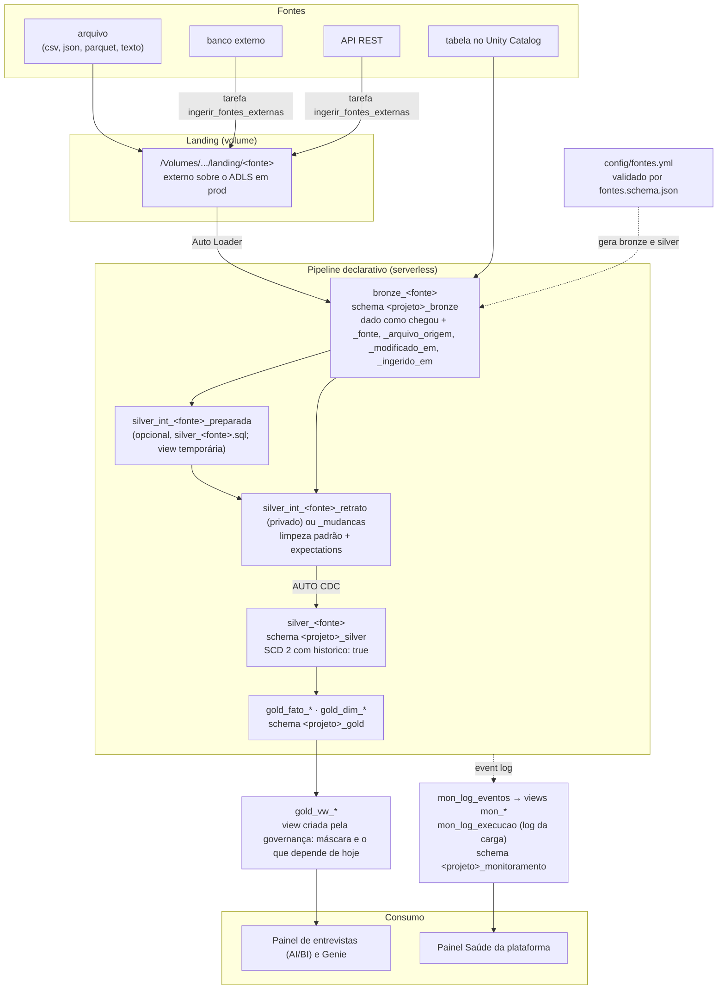
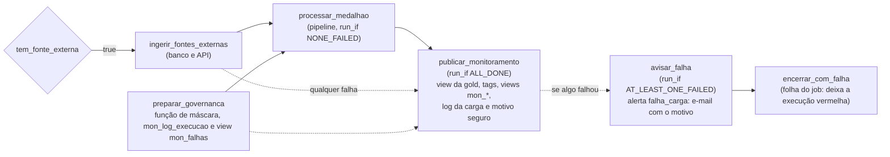

# Arquitetura

Como o pacote Essentials organiza os dados, do arquivo que chega à landing até os
painéis. As decisões por trás de cada escolha estão em [`docs/adr/`](adr/README.md).

## Fluxo dos dados



- **Bronze e silver são genéricas** (`src/pipeline/bronze.py` e `silver.py`): cada item
  do `fontes.yml` vira suas tabelas (ADR 0007).
- **As regras de qualidade ficam numa tabela intermediária**, e não numa view, porque o
  AUTO CDC FROM SNAPSHOT lê a origem como um retrato e não aplica expectations de views
  (ADR 0009). No modo incremental, ficam na própria `silver_<fonte>`.
- **O retrato do snapshot é privado do pipeline:** não aparece no catálogo. A silver é uma
  só, em SCD tipo 2 (ADR 0019).
- **AUTO CDC** nos modos `snapshot` e `cdc`, com histórico SCD tipo 2 opcional (ADR 0008).
- **O painel lê só a view da gold**, que aplica a máscara de dado pessoal e calcula o que
  depende de hoje (ADR 0020).

## A carga diária (job)



Job `<projeto>_job_carga_diaria`, às 6h (America/Sao_Paulo) em prod; pausado em
dev. A ingestão de banco e API só roda quando o `fontes.yml` tem fonte daquele tipo (a
variável `ingerir_fontes_externas`, conferida por teste); sem fonte, a tarefa aparece como
pulada e não custa nada (ADR 0004). As tarefas, na ordem:

| Tarefa | O que faz |
|---|---|
| `tem_fonte_externa` | condição, sem computação: o `fontes.yml` tem fonte banco ou API? |
| `ingerir_fontes_externas` | traz bancos e APIs para a landing; pulada quando não há fonte |
| `preparar_governanca` | cria a função de máscara, a tabela `mon_log_execucao` e a view `mon_falhas` |
| `processar_medalhao` | o pipeline: bronze, silver e gold (`full_refresh: false`) |
| `publicar_monitoramento` | roda com qualquer resultado (`ALL_DONE`): view da gold, tags, views `mon_*`, log da carga, log legível e o motivo seguro das falhas |
| `avisar_falha` | só se alguma tarefa falhou: avalia o alerta `falha_carga` na hora |
| `encerrar_com_falha` | só depois do aviso: `raise_error` de texto fixo, para a execução ficar vermelha |

A `publicar_monitoramento` só termina com erro se uma etapa dela falhar: o serverless
repete tarefas Python que terminam com erro, e o bundle omite `max_retries: 0` (valor zero),
então sair com erro por causa da falha de outra tarefa faria a tarefa rodar 3 vezes. O
resultado do job sai das tarefas folha; por isso a `encerrar_com_falha` existe (ADR 0021).

| Aviso | Quando | Origem |
|---|---|---|
| Falha e demora (mais de 15 minutos) | na hora | e-mail do job, para o cliente e o suporte |
| `falha_carga` | na hora (tarefa `avisar_falha`) e às 7h, como rede de segurança | alerta SQL sobre `mon_falhas`, com o motivo; `retrigger_seconds` de 3600, para uma nova falha avisar de novo |
| `qualidade_carga` | 7h | alerta SQL sobre `mon_volume` e `mon_estrutura` (ADR 0014) |
| `qualidade_carga` (avisos de arquivo) | 7h | `arquivo_ignorado` (o último arquivo não virou o retrato) e `codificacao_invalida` (acentos trocados), em `mon_estrutura` (ADR 0016); mostram só o nome do arquivo |
| `custo_teto` | 8h | alerta SQL sobre a linha `total` de `mon_custo_mensal`, a partir de 80% do teto (ADR 0023) |
| `atraso_carga` | 9h | alerta SQL sobre `mon_atualizacao`, acima de 26 horas (ADR 0003) |

No dev, só o `falha_carga` fica ativo (avisa o usuário do workspace); no `ci`, os alertas
ficam pausados. Em prod, os alertas avisam também o suporte da Logos.

## Observabilidade e custo

**Log da carga (ADR 0022).** A tabela `mon_log_execucao` tem uma linha por execução e nível:
`job`, `tarefa` e `tabela`. Cada linha traz início, fim, duração (em segundos e em
`hh:mm:ss`), status, o método de carga (`APPEND (Auto Loader)`, `AUTO CDC FROM SNAPSHOT
SCD2`, `MATERIALIZED VIEW`, `VIEW`), a técnica de refresh que o motor escolheu
(`COMPLETE_RECOMPUTE`, `WINDOW_FUNCTION`, `ROW_BASED`, `NO_OP`...), as linhas gravadas,
descartadas e em alerta, o total na tabela, a última atualização anterior, o motivo seguro e
o link. O log por tabela vem do event log no fim da carga: o pipeline é declarativo e não há
código nosso por tabela. As expectations do retrato privado são atribuídas à `silver_agenda`.
A gravação é um MERGE pela chave: repetir a mesma execução não duplica.

**Log legível.** Toda tarefa Python escreve na saída `[AAAA-MM-DD hh:mm:ss]-[NIVEL]:
mensagem`, no fuso da variável `fuso_horario` (`America/Sao_Paulo`). A
`publicar_monitoramento` imprime o resumo da carga: início do job, cada tabela, cada tarefa,
cada falha e o fim do job.

**Falhas.** `mon_falhas` é uma view sobre `mon_log_execucao`, com as colunas que o alerta
`falha_carga` lê. Se existia a tabela antiga com esse nome, ela é renomeada para
`mon_falhas_legado`, nunca apagada.

**Custo (ADR 0023).** `mon_custo_diario` atribui o consumo pela tag `projeto`: jobs pela
cobrança e por `system.lakeflow.jobs`, pipelines por `system.lakeflow.pipelines`. Assim cobre
`dev`, `ci` e `prod`, inclusive recursos recriados. O SQL warehouse só entra com a variável
`warehouse_dedicado` igual a `"true"`: no Free Edition ele é compartilhado e fica fora, como
o armazenamento e a otimização preditiva. `mon_custo_mensal` soma por ambiente e no total,
com a projeção do mês (a do total é a soma das projeções dos ambientes), e o alerta
`custo_teto` lê a linha `total`. `mon_custo_por_carga` dá o custo de lista de cada execução
(job e pipeline, com as novas tentativas e o uso por hora rateado). Os valores são o preço
de lista; no dev, em 2026-11-05, ficaram em cerca de US$ 0,12 por carga no `dev` e US$ 0,17
no `ci`.

**Permissões de sistema.** O service principal de prod precisa de `SELECT` em
`system.billing` e `system.lakeflow` (concedido pelo metastore admin). Sem isso, as views de
custo não são criadas e o log mostra só um aviso.

## Estrutura no Unity Catalog

**No Free Edition (target `dev`):**

```
essentials                                      ← catálogo do pacote (um só para todos os projetos)
├── dev_<usuário>_portfolio_bronze              ← bronze_agenda e o volume landing: só a engenharia
│   └── landing (volume)                        ← /Volumes/essentials/dev_<usuário>_portfolio_bronze/landing/<fonte>/
├── dev_<usuário>_portfolio_silver              ← silver_agenda e a função mascarar_dado_pessoal: só a engenharia
├── dev_<usuário>_portfolio_gold                ← gold_fato_entrevista e gold_vw_entrevistas: leitura para o negócio
└── dev_<usuário>_portfolio_monitoramento       ← mon_log_eventos, mon_log_execucao e views mon_*: só a engenharia
```

Os schemas, o volume e as permissões são criados pelo bundle
(`resources/governanca.yml`). Em dev, o modo development prefixa os schemas com
`dev_<usuário>_`, isolando cada desenvolvedor; o target `ci` usa o projeto
`<projeto>_ci` (ADR 0005). No cliente (target `prod`), o catálogo é o dele (`prd`), os
schemas são `<projeto>_bronze`, `<projeto>_silver`, `<projeto>_gold` e
`<projeto>_monitoramento`, e a landing é um volume externo sobre o ADLS. O `setup/` cria só
o catálogo (ADR 0018).

**No bundle:** o nome é `essentials_<projeto>` e a variável `projeto` gera os schemas e os
nomes do job (`<projeto>_job_carga_diaria`) e do pipeline (`<projeto>_pipeline_medalhao`).
As chaves internas dos recursos (`essentials_carga_diaria`, `essentials_pipeline`) não
mudam, para o bundle não recriar nada. Os padrões de nomes de tabelas e colunas estão em
[`docs/padroes/nomes.md`](padroes/nomes.md).

### Quem acessa o quê

| Grupo (variável do bundle) | Bronze, silver e monitoramento | Gold e painel | Landing | Dado pessoal na gold |
|---|---|---|---|---|
| `grupo_engenharia` | tudo | tudo | lê e grava | conforme o grupo abaixo |
| `grupo_leitura_gold` | nada | lê | nada | vê `****` |
| `grupo_dados_pessoais` | — | — | — | vê o valor |

Decisões em [ADR 0018](adr/0018-schemas-por-camada.md) (que substitui em parte o
[ADR 0001](adr/0001-modelo-de-acesso-no-unity-catalog.md)),
[ADR 0002](adr/0002-dados-pessoais-no-unity-catalog.md) e
[ADR 0020](adr/0020-exemplo-sem-cargos-e-view-que-mascara.md). As colunas com dado pessoal
levam a tag `pii` no Unity Catalog, e toda tabela e view publicada leva as tags `camada` e
`tipo`, copiadas das `TBLPROPERTIES`.

## O `config/fontes.yml`

Cada fonte informa: `nome`, `tipo` (arquivo, tabela, banco ou api), o bloco do tipo,
`modo_carga` (incremental, snapshot ou cdc), `historico`, `chave_primaria`,
`coluna_atualizacao`, `colunas` (nome padronizado, `origem`, tipo, formatos de data,
caixa, de-para, máscara, `sensivel`) e `regras` (nao_nulo, valores_aceitos, expressao,
unico, com ação drop, alerta ou falhar). Os campos estão explicados nos comentários do
próprio arquivo, e o formato é validado por
[`config/fontes.schema.json`](../config/fontes.schema.json) no pytest e no começo de cada
execução do pipeline.

| Tipo | Como chega à bronze | Testado |
|---|---|---|
| `arquivo` | Auto Loader lê a pasta da fonte na landing: CSV, JSON e Parquet (coluna nova vai para `_rescued_data`), texto e Excel (`.xlsx`) | no Free Edition (Excel num pipeline de teste) |
| `tabela` | lê a tabela do Unity Catalog (MV no snapshot, streaming nos outros modos) | no Free Edition |
| `banco` | `src/ingestao/banco_para_landing.py` lê pelo Lakehouse Federation, com watermark, e grava parquet na landing | ainda não (o Free Edition restringe acesso externo) |
| `api` | `src/ingestao/api_para_landing.py` chama a API com token do secret scope e grava JSON na landing | ainda não (o Free Edition restringe acesso externo) |

**Regras que vêm sozinhas:** cada coluna da `chave_primaria` sem regra `nao_nulo` ganha
uma com `drop` (`chave_<coluna>_preenchida`), e no modo incremental a chave inteira ganha
uma regra `unico` (`chave_unica`). Nos modos snapshot e cdc a chave já sai única pelo
AUTO CDC. A ação **`falhar`** para a carga inteira: é para regras que indicam arquivo
errado (no exemplo, `data_plausivel`), não linha ruim.


## Fontes do exemplo

| Fonte | Tipo | Modo | Chave | Detalhe |
|---|---|---|---|---|
| `agenda` | arquivo (texto) | snapshot + histórico | `dt_entrevista`, `nm_candidato` | a planilha do ano inteiro é reenviada a cada vez; a data só aparece na linha `AGENDA DIA`, tratada em `silver_agenda.sql` |

O exemplo tem uma só fonte. A área da vaga não vem de um cadastro: é um de-para de
prefixos do nome da vaga, numa CTE da `gold_fato_entrevista` (ADR 0020).

## Tabelas geradas

São 3 tabelas publicadas e 1 view na cadeia da agenda, mais o retrato privado do pipeline.

| Tabela | Schema | Objeto | Camada · tipo | O que tem |
|---|---|---|---|---|
| `bronze_agenda` | `<projeto>_bronze` | streaming table | bronze · bruta | cada arquivo da agenda inteiro numa linha (`value`), como chegou, mais `_modificado_em` |
| `silver_int_agenda_preparada` | (só no pipeline) | view temporária | silver · intermediária | uma linha por entrevista, com a data do separador repetida |
| `silver_int_agenda_retrato` | (só no pipeline) | materialized view **privada** | silver · intermediária | último retrato limpo; **regras de qualidade da agenda**; não aparece no catálogo (ADR 0019) |
| `silver_agenda` | `<projeto>_silver` | streaming table (AUTO CDC, SCD 2) | silver · histórico | uma linha por versão de cada entrevista, com `__START_AT` e `__END_AT`; a vigente tem `__END_AT` vazio |
| `gold_fato_entrevista` | `<projeto>_gold` | materialized view | gold · fato | uma linha por entrevista vigente, com a área (de-para), `st_situacao`, `fl_compareceu` e `fl_aprovado`; `MASK` em nome e telefone |
| `gold_vw_entrevistas` | `<projeto>_gold` | view | gold · view | a fato mais `fl_sem_retorno` (depende de hoje); aplica a máscara em nome e telefone; o painel lê só ela |
| `mon_log_eventos` | `<projeto>_monitoramento` | event log do pipeline | monitoramento | todos os eventos das atualizações do pipeline |
| `mon_qualidade_diaria` | view | monitoramento · qualidade | por dia, tabela e regra: aprovadas, descartadas e alertas |
| `mon_atualizacao` | view | monitoramento · atualização | última carga do pipeline e último dado novo de cada silver |
| `mon_log_execucao` | `<projeto>_monitoramento`, tabela | monitoramento · observabilidade | uma linha por execução e nível (job, tarefa, tabela): tempos, método de carga, técnica de refresh, linhas, motivo seguro e link (ADR 0022) |
| `mon_custo_diario` | view | monitoramento · custo | DBUs e custo de lista do projeto por dia, ambiente e recurso, atribuídos pela tag `projeto` |
| `mon_custo_mensal` | view | monitoramento · custo | custo do mês por ambiente e total, com a projeção, contra o teto do diagnóstico |
| `mon_custo_por_carga` | view | monitoramento · custo | custo de lista de cada execução do job (job e pipeline, com as novas tentativas) |
| `mon_volume` | view | monitoramento · volume | linhas de cada carga; alerta de retrato vazio ou em queda |
| `mon_estrutura` | view | monitoramento · estrutura | colunas novas na origem, dados resgatados, arquivo ignorado e codificação inválida |
| `mon_execucoes` | view | monitoramento · execuções | execuções, sucessos, falhas e taxa de sucesso por dia |
| `mon_falhas` | view | monitoramento · falha | falhas da carga (uma linha por tarefa) com o motivo, sem dado pessoal; lê `mon_log_execucao` |

As `mon_*` ficam no schema `<projeto>_monitoramento`. A `mon_log_execucao` e a view
`mon_falhas` são criadas pela `preparar_governanca`, e as demais views, pela
`publicar_monitoramento` ([ADR 0003](adr/0003-monitoramento-fora-do-pipeline.md) e
[ADR 0021](adr/0021-tarefa-final-de-monitoramento-e-aviso-de-falha-na-hora.md)). Elas leem
metadados (event log, `information_schema`, tabelas de sistema), com duas exceções:
`codificacao_invalida` e `arquivo_ignorado` leem a bronze, um arquivo e uma coluna. Como o
retrato é privado, esses dois avisos acham o arquivo dele pelas versões vigentes da silver.

### Regras de qualidade da agenda

| Regra | Ação | O que verifica |
|---|---|---|
| `nome_preenchido` | drop | `nm_candidato` preenchido |
| `data_entrevista_valida` | drop | `dt_entrevista` reconhecida (`dd/MM/yyyy` ou `yyyy-MM-dd`) |
| `status_conhecido` | alerta | `st_entrevista` dentro da lista depois do de-para |
| `telefone_valido` | alerta | `nr_telefone` com 10 ou 11 dígitos (um número que o Excel converteu para `4,19E+10` não passa) |
| `horario_valido` | alerta | `hr_entrevista` no formato `HH:mm` |
| `data_plausivel` | falhar | `dt_entrevista` vazia ou a partir de 2020-01-01; antes disso, a carga para |

O status passa por um de-para no YAML (`Aprovada` → `Aprovado`, `N/ atendeu` → `Não
atendeu`, `Cancelou` → `Cancelado`, vazio → `Pendente`), e o telefone sai mascarado
(`(41) ****-1234`) por causa da LGPD. Nos modos snapshot e cdc, toda coluna da chave
precisa de uma regra `nao_nulo` com `drop`: o AUTO CDC não aceita chave nula.

## Dicionário de dados

Toda coluna da silver e da gold tem descrição no Unity Catalog. O cliente consulta pelo
**Catalog Explorer** (aba **Columns** de cada tabela) ou por SQL, e o Genie e o Assistant
usam as mesmas descrições para entender os dados.

| Onde a descrição nasce | Como chega ao Unity Catalog |
|---|---|
| Colunas da silver | campo `descricao` de cada coluna no `config/fontes.yml` (obrigatório) → `silver.py` cria as tabelas com o schema do contrato e `COMMENT` por coluna |
| Colunas técnicas (`_fonte`, `_arquivo_origem`, `_modificado_em`, `_ingerido_em`) e do histórico (`__START_AT`, `__END_AT`) | descrições padrão em `src/essentials/config_fontes.py` |
| Colunas da fato da gold | lista de colunas com tipo e `COMMENT` em cada `CREATE OR REFRESH MATERIALIZED VIEW` |
| Colunas das views da gold | lista de colunas com `COMMENT` em cada `src/views/gold_vw_*.sql` (criada pela `publicar_monitoramento`, que aplica o `COMMENT` de cada coluna) |
| Colunas das views `mon_*` | `COMMENT` gerado por `src/essentials/monitoramento_sql.py` |
| Colunas de `mon_log_execucao` | `COMMENT` gerado por `src/essentials/log_sql.py` |

A silver tem **contrato explícito**: só entram as colunas declaradas no YAML (e as
técnicas). Colunas da origem que não foram declaradas ficam só na bronze, então nenhuma
coluna chega à silver sem descrição. Os testes garantem isso: o YAML recusa coluna sem
`descricao`, e a gold recusa coluna sem tipo e `COMMENT`.

Para exportar o dicionário (por exemplo, para uma planilha de entrega ao cliente), troque
`<projeto>` pelo nome do projeto (em dev, com o prefixo `dev_<usuário>_`):

```sql
SELECT table_name AS tabela, column_name AS coluna, full_data_type AS tipo, comment AS descricao
FROM essentials.information_schema.columns
WHERE table_schema IN ('<projeto>_silver', '<projeto>_gold')
  AND (table_name LIKE 'silver%' OR table_name LIKE 'gold%')
ORDER BY table_name, ordinal_position;
```

## Painéis AI/BI

O painel **Essentials · portfolio · Entrevistas** é versionado como código
(`src/dashboards/entrevistas.lvdash.json` + `resources/dashboard.yml`) e implantado pelo
mesmo `bundle deploy` do pipeline. Ele usa o **Databricks AI/BI**: roda no SQL warehouse
serverless, não cobra licença por usuário e respeita as permissões do Unity Catalog
(`embed_credentials: false`: quem não tem acesso à gold não vê os dados).

| Página | Conteúdo |
|---|---|
| **Visão geral** | contadores de entrevistas, comparecimento e aprovação; barras por mês e situação (concluído, em andamento, pendente); pizza por status; filtros de período e área |
| **Áreas e vagas** | comparecimento e aprovação por área; entrevistas por vaga e situação; filtros de período e área |
| **Pendências** | lista de trabalho do RH: entrevistas sem retorno, status não identificado e vagas sem área (Não classificada), com filtro por motivo |

A situação (`st_situacao`) e a área são calculadas na gold, não no painel: regra de negócio
fica no modelo de dados. Já os totais por mês e por área são calculados nos datasets do
painel, sem tabela agregada. As consultas do painel leem só a view `gold_vw_entrevistas` e
não citam catálogo nem schema; o bundle aponta para o ambiente certo com `dataset_catalog`
e `dataset_schema`. O warehouse é localizado pelo nome (`lookup` da variável
`warehouse_id`).

**Ajustes visuais feitos na tela** (cores, posições) voltam para o repositório com:

```
databricks bundle generate dashboard --resource painel_entrevistas --force -t dev
```

**Saúde:** um segundo painel (`src/dashboards/saude.lvdash.json`), só para a engenharia, lê
as tabelas e views `mon_*` do schema `<projeto>_monitoramento`. É separado para o negócio
não ver o monitoramento (ADR 0018). Tem duas páginas:

| Página | Conteúdo |
|---|---|
| **Saúde da plataforma** | atraso, taxa de sucesso, falhas, volume, estrutura da origem, qualidade (só das regras do `fontes.yml` atual), custo do mês por ambiente, projeção do mês, custo por carga, custo diário por ambiente e produto, e um texto que explica o preço de lista e o que fica fora |
| **Saúde da carga** | última execução por tarefa e por tabela, duração e descartes por dia, e falhas com o motivo |

**Genie (opcional):** no painel, ative um espaço Genie sobre `gold_vw_entrevistas` (que já
vem mascarada) para perguntas livres, como "quantos aprovados em Cozinha em setembro?".

## Estrutura de pastas

```
.
├── databricks.yml                 # bundle, variáveis e targets dev, ci e prod
├── config/                        # fontes.yml (o que muda por cliente) e o JSON Schema dele
├── resources/                     # pipeline, job, governança (schemas, volume, grants), painéis, alerta
├── src/
│   ├── essentials/                # lógica sem Spark: config, governança e monitoramento (testada)
│   ├── pipeline/                  # bronze.py e silver.py genéricas, silver_<fonte>.sql, gold_*.sql
│   ├── views/                     # gold_vw_*.sql: views da gold criadas pela governança
│   ├── ingestao/                  # ingerir_fontes_externas: banco e API para a landing
│   ├── governanca/                # tarefas do job: preparar_governanca, publicar_monitoramento e encerrar_com_falha
│   └── dashboards/                # painéis AI/BI como código
├── setup/00_setup_free_edition.sql  # só o catálogo e o USE CATALOG (Free Edition)
├── data/gerar_dados_exemplo.py    # gera as agendas fictícias v1 e v2 (o resto de data/ fica fora do Git)
├── scripts/                       # perfilar_dados.py (perfil sem dados pessoais) e integracao.py
├── tests/                         # unidade (pytest -q) e integracao/ (workflow integracao.yml)
├── docs/                          # arquitetura, guias, padrões, ADRs e roteiro de operação
├── .github/                       # workflows ci, deploy e integracao; Dependabot; templates
├── .claude/                       # permissões, hooks, subagentes e skills do Claude Code
├── CHANGELOG.md
└── CLAUDE.md
```
