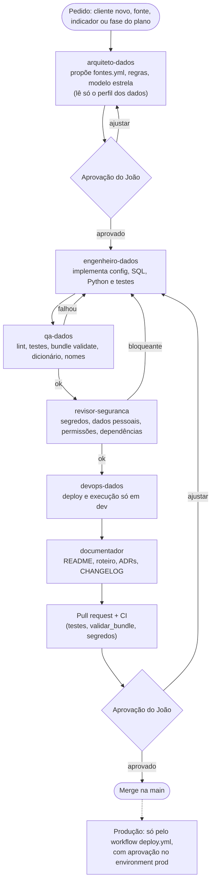

# Desenvolvimento: IA, CI/CD e cadeia de suprimentos

Como o projeto é desenvolvido e entregue. O dia a dia (branch, PR, validação,
implantação) está em [`docs/padroes/fluxo-de-trabalho.md`](padroes/fluxo-de-trabalho.md).

## Desenvolvimento com Claude Code

O projeto vem com uma camada de IA versionada em `.claude/`, para que o uso de agentes
siga as mesmas regras do time ([ADR 0012](adr/0012-guardrails-do-claude-code.md)):

| Peça | O que faz |
|---|---|
| `.claude/settings.json` | **permissões**: libera lint, testes e `bundle validate`; pede confirmação para deploy, run, commit e push; **nega** produção, `destroy`, push forçado e leitura de `.env` e dados reais |
| `.claude/hooks/` | **guardrails determinísticos** em Python: bloqueiam comandos de produção e destroy, push na `main`, leitura de dados reais e tokens; rodam o ruff em todo `.py` editado; restringem o que o QA e o documentador editam |
| `scripts/perfilar_dados.py` | **perfil sem dados pessoais**: o modelo entende a estrutura de um arquivo do cliente sem ver nomes, CPFs ou telefones |
| `.claude/agents/` | 6 subagentes: arquiteto, engenheiro, QA, DevOps, revisor de segurança e documentador |
| `.claude/skills/` | 8 skills: novo cliente, nova fonte, novo indicador, revisão de qualidade, implantar em dev, revisar PR, ADR e entrega |
| `tests/evals/` | casos de avaliação das skills críticas, com dados fictícios |

O princípio: **o que não pode falhar vira permissão ou hook; o que é orientação fica no
`CLAUDE.md` ou numa skill.** Os padrões estão em `docs/padroes/` e os hooks são testados
em `tests/test_hooks.py`.

### Fluxo de uma mudança grande



Nenhum agente implanta em produção: o `-t prod` é negado nas permissões e bloqueado pelo
hook, e o deploy de produção só acontece pelo GitHub Actions
([ADR 0011](adr/0011-deploy-de-producao-por-oidc.md)).

## CI/CD

| Workflow | Gatilho | O que faz |
|---|---|---|
| `ci.yml` | pull request para a `main` | `ruff check .`, `pytest -q` (só testes de unidade, inclui a validação do `fontes.yml`, dos padrões e da documentação), `databricks bundle validate -t dev` e varredura de segredos no histórico (gitleaks) |
| `integracao.yml` | 1h de segunda a sexta e manual (nunca em PR) | implanta o target `ci`, carrega a agenda fictícia v1 e a v2, confere os dados (`tests/integracao/`) e destrói tudo no fim |
| `deploy.yml` | manual (`workflow_dispatch`) | `bundle validate` e `bundle deploy -t prod` no environment `prod`, com login OIDC |

- **Testes de integração** ([ADR 0005](adr/0005-testes-de-integracao.md)): o target `ci`
  usa o projeto `<projeto>_ci`, com schemas e estado de deploy próprios, sem tocar no dev.
  As asserções conferem linhas na silver, descartes e alertas por regra, chaves sem nulo
  e sem duplicata, versões no histórico após a v2, fato completa e agregada igual à fato.
- **Testes por risco:** todo teste protege contra dado errado, vazamento de dado pessoal,
  custo, deploy quebrado ou falha de segurança. Forma e ordem de ADRs e do CHANGELOG não
  são testadas (só links quebrados). A matriz está em
  [`cenarios-reais.md`](cenarios-reais.md).
- **Cenários de integração:** com `cenarios_de_falha`, o `integracao.yml` envia, depois da
  v1 e da v2, as agendas v5 (reenvio da v2 com outro nome), v6 (a v1 chegando atrasada),
  v7 (só cabeçalho), um full refresh (que precisa ser recusado), v8 (a v2 em cp1252), v3 (queda de volume e coluna
  nova) e v4 (regra que para a carga). Cada cenário parte do estado do anterior.
- `DATABRICKS_HOST_DEV` (variável do repositório) é a URL do workspace de dev; o
  `databricks.yml` não traz o host.
- O Free Edition não oferece service principal com OIDC, por isso o CI de dev usa token.
- Quando houver produção, ative o deploy automático descomentando o `push` em `deploy.yml`.
- Nada é alterado à mão em produção: tudo passa pelo bundle.

## Cadeia de suprimentos

Detalhes e motivos em [ADR 0013](adr/0013-cadeia-de-suprimentos.md).

- **Actions fixadas pelo SHA do commit**, com a versão em comentário: uma tag pode ser
  movida para outro código, um SHA não.
- **Dependências com versão fixa** num único arquivo, `requirements-runtime.txt`, que o
  pipeline e o job instalam com `-r`; o `requirements-dev.txt` o inclui.
- **Dependabot** (`.github/dependabot.yml`) propõe toda semana as atualizações de actions
  e pacotes, só de versões publicadas há pelo menos 14 dias.
- **Permissões mínimas**: cada job do GitHub Actions declara só o que usa.

## pre-commit

As mesmas verificações do CI rodam na sua máquina antes de cada commit: ruff, YAML e
JSON válidos, fim de arquivo, espaços sobrando, chave privada e segredos (gitleaks).

```
pip install -r requirements-dev.txt
pre-commit install            # uma vez: ativa o hook de commit deste repositório
pre-commit run --all-files    # opcional: verifica tudo de uma vez
```

## Versões

O projeto usa versões semânticas, com uma tag por fase do plano de evolução
(`v0.1.0` = estado antes do plano). As mudanças de cada versão estão no
[`CHANGELOG.md`](../CHANGELOG.md).
